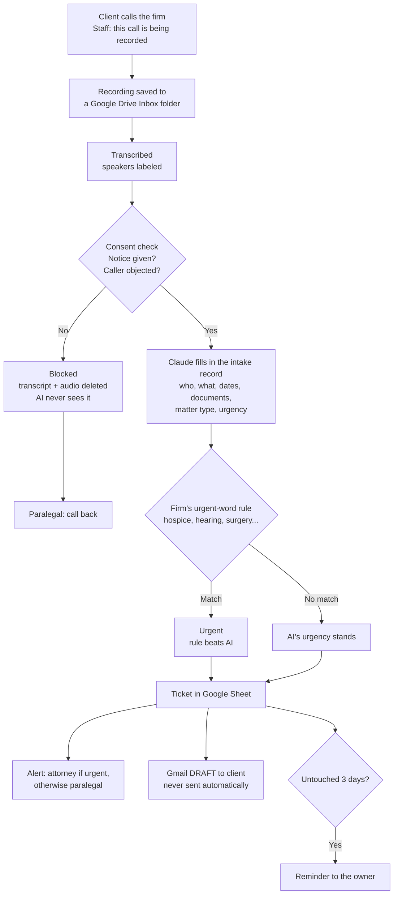

# Law firm intake automation (demo)

A call comes in and becomes a ticket: sorted, routed to the right person, with a reply drafted
and a reminder if it stalls, and nobody retypes anything. It's built for a small estate-planning
and probate practice, runs inside Google Workspace, and uses only made-up clients.

## What it shows

- **Intake without retyping.** Claude reads the call into a fixed form. If something wasn't said,
  the field stays blank; it doesn't guess.
- **Rules the firm controls.** Urgency triggers, routing, reminder timing and email wording live in a
  spreadsheet tab, not in code.
- **A person stays in charge.** Client emails are drafts. Urgent tickets need a staff member to
  confirm them. Every step is logged.
- **Confidentiality by design.** Everything stays in the firm's own Google account. The outside
  transcription copy is deleted once read, and AI goes through the API, not a consumer chat app.
- **Florida recording consent.** All parties must consent (Fla. Stat. § 934.03), so a call without
  the notice, or where the caller objects, is never processed.
- **Tested against written expectations.** Every rule has a scenario in
  [ACCEPTANCE.md](ACCEPTANCE.md) and an automated check (`npm test`, 31 checks).

## Read more

| Page | What's in it |
|---|---|
| [PROBLEM.md](PROBLEM.md) | The firm's problem, and who it hurts |
| [WORKFLOW.md](WORKFLOW.md) | Diagrams: each step, the ticket lifecycle, where data goes |
| [ACCEPTANCE.md](ACCEPTANCE.md) | The business rules and the QA scenarios |

**Built with:** Google Apps Script, Sheets, Gmail and Drive · Claude API (Anthropic) · AssemblyAI
(speech to text) · Twilio (optional phone line) · Node.js tests.
