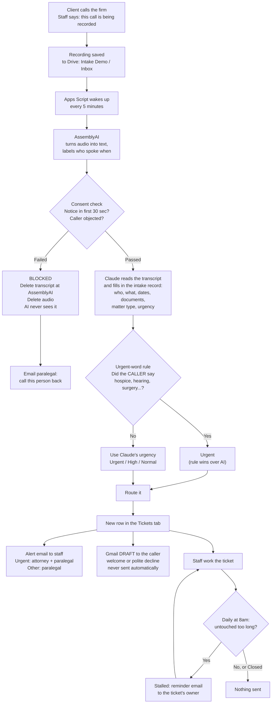
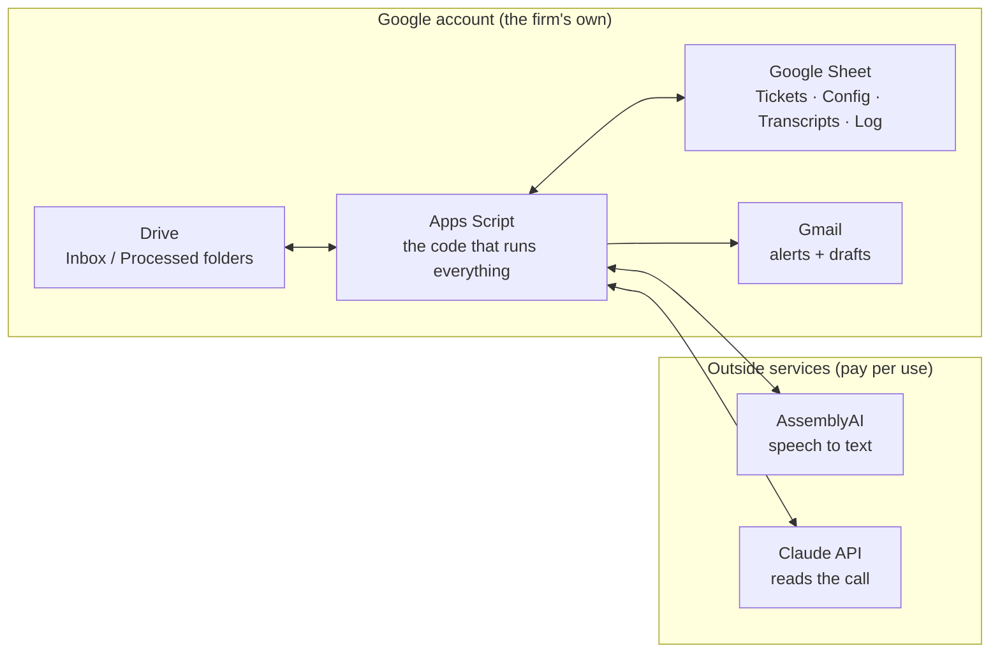
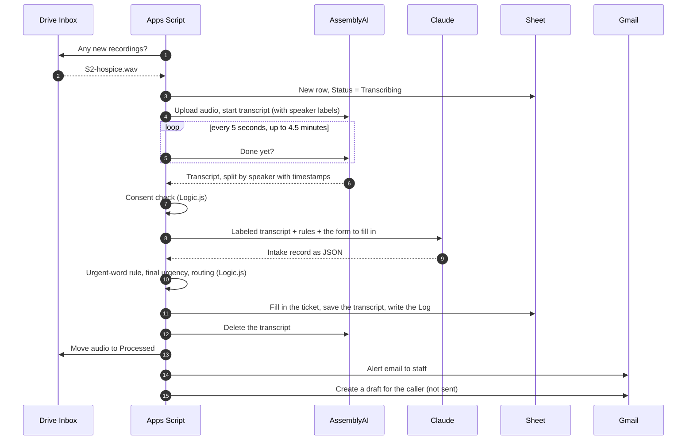
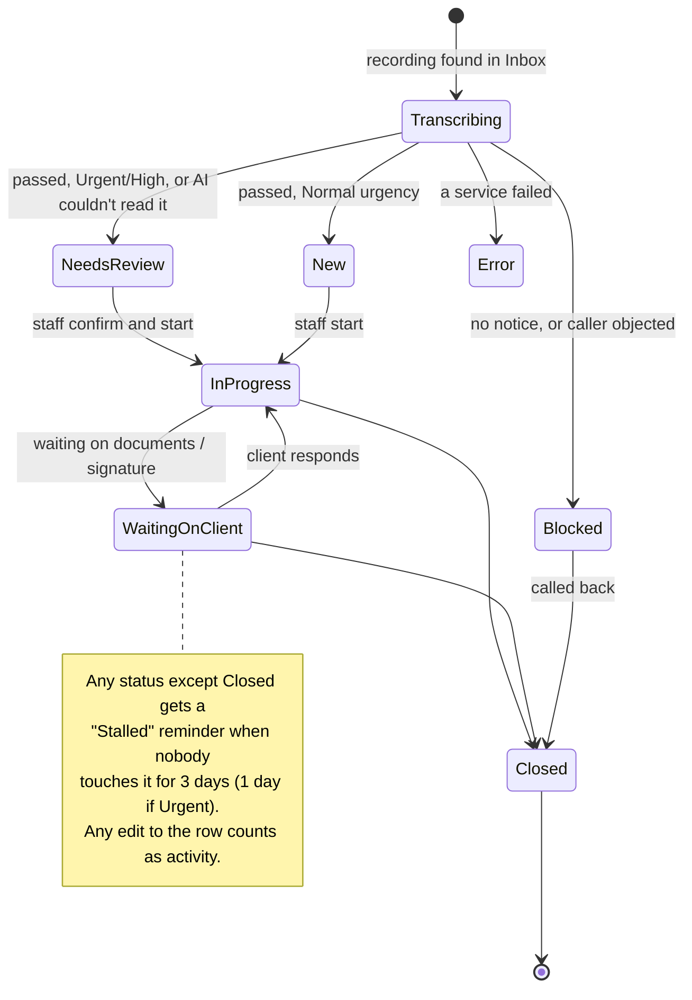
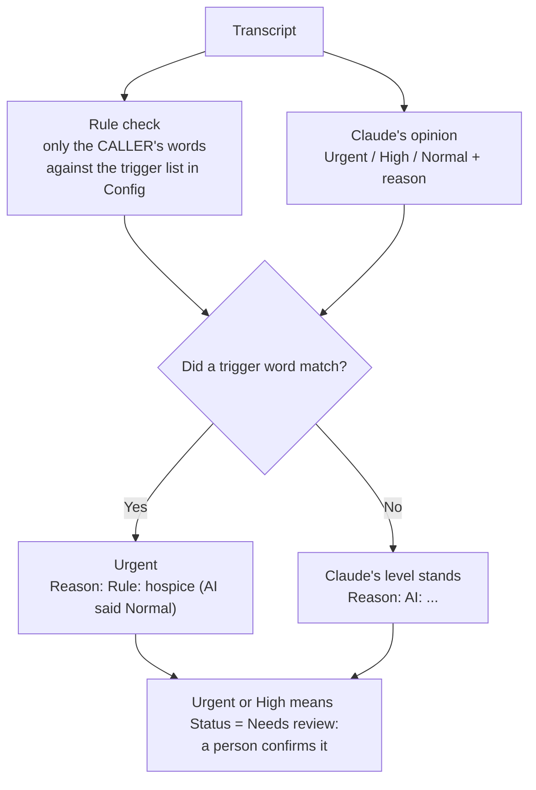
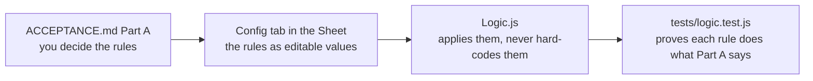
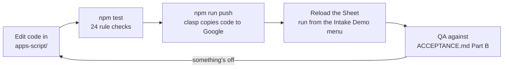

# How the intake demo works

This page shows how a phone call becomes a ticket, what each piece does, and where each piece
lives. The *why* is in [PROBLEM.md](PROBLEM.md). The exact rules and expected results are in
[ACCEPTANCE.md](ACCEPTANCE.md).

> The diagrams are written in Mermaid. GitHub shows them as pictures. In VS Code, install the
> "Markdown Preview Mermaid Support" extension, then open this file and press `Ctrl+Shift+V`.

---

## 1. The big picture

**One sentence:** a recording goes in, and out comes a ticket that's sorted, routed and has an
email ready, and nobody retypes anything.

---

## 2. The pieces and where they live

| Piece | What it does | Where you see it |
|---|---|---|
| **Drive: Inbox** | Where recordings are dropped | Intake Demo → Open the Inbox folder |
| **Drive: Processed** | Where recordings go after they're read | Next to Inbox |
| **Apps Script** | Runs the pipeline every 5 minutes, and whenever you pick it from the menu | Sheet → Extensions → Apps Script |
| **Tickets tab** | One row per call. This is the paralegal's work list | The Sheet |
| **Config tab** | Every business rule, editable without code | The Sheet |
| **Transcripts tab** | The labeled transcript for each ticket, for checking the AI | The Sheet |
| **Log tab** | What happened at each step, including whether the AI was called | The Sheet |
| **AssemblyAI** | Turns audio into text and tells the speakers apart | Outside; we delete each transcript once read |
| **Claude** | Turns the transcript into a structured intake record | Outside; gets the transcript only, never the audio |
| **Gmail** | Staff alerts are sent. Client emails are **drafts only** | The demo account's inbox and Drafts folder |

---

## 3. One call, step by step

This shows who talks to whom, in order, for a call that passes the consent check.

For a **blocked** call, the flow stops after step 6. The transcript and audio are deleted, only
the time, file name and reason stay on the ticket, and the paralegal gets a "call back" email.
Claude is never contacted.

---

## 4. The life of a ticket

The **Status** column in the Tickets tab moves like this. The pipeline sets the first status, and
staff change it after that.

---

## 5. How urgency is decided

Two opinions go in, and a fixed rule decides which one wins.

**Why only the caller's words:** staff often ask "is there any court date?". If staff speech
counted, every call would come out Urgent. Test S3b checks this.

**Why the rule wins:** a keyword rule is predictable and easy to explain to a lawyer. The AI
catches the cases the rule misses, like "surgery next Tuesday", and a person confirms anything
Urgent or High.

---

## 6. Where the client's data goes, and when it's deleted

| Data | Goes to | Kept? |
|---|---|---|
| Audio | Drive (firm's account) → AssemblyAI | AssemblyAI copy deleted after reading. Drive copy moves to Processed. **Blocked calls: deleted everywhere.** |
| Transcript | AssemblyAI → Apps Script → Claude → Transcripts tab | Deleted at AssemblyAI. Claude gets the text only; kept in the firm's own Sheet |
| Intake record | Tickets tab, alert emails, the Gmail draft | Stays in the firm's Google account |
| API keys | Apps Script's Script Properties | Never in the Sheet, never in this repo |

Everything the firm keeps lives in **their own** Google account. That's the confidentiality
answer in one line.

---

## 7. Where the rules live

To change a rule, such as making stalls 5 days or adding a trigger word, **edit the Config tab**.
No code change and no push are needed.

---

## 8. How changes get made (the build loop)

| Command | What it does |
|---|---|
| `npm test` | Runs the rule checks locally in about 1 second. No Google, no API cost |
| `npm run calls` | Rebuilds the fake call recordings from `calls/scripts/*.txt` |
| `npm run smoke -- S2` | Sends a fake call through the real AssemblyAI and Claude from your PC and prints the result. Add `--no-ai` to skip Claude |
| `npm run push` | Sends the code in `apps-script/` to the LawDemo Apps Script project |

---

## 9. Files in this repo

| File | What's in it |
|---|---|
| [PROBLEM.md](PROBLEM.md) | What's broken at the firm and who it hurts |
| [ACCEPTANCE.md](ACCEPTANCE.md) | Business rules (Part A) and the scenarios QA checks (Part B) |
| [apps-script/Logic.js](apps-script/Logic.js) | Every business rule, as plain functions |
| [apps-script/Pipeline.js](apps-script/Pipeline.js) | Recording → transcript → consent → AI → ticket |
| [apps-script/Services.js](apps-script/Services.js) | Talking to AssemblyAI and Claude |
| [apps-script/Notify.js](apps-script/Notify.js) | Alerts, Gmail drafts, stall reminders |
| [apps-script/Setup.js](apps-script/Setup.js) | Menu, tabs, folders, schedules, API keys |
| [tests/logic.test.js](tests/logic.test.js) | Automated checks, one per rule |
| [calls/](calls/) | Fake call scripts and the voice generator |
| [tools/smoke.js](tools/smoke.js) | Local end-to-end check against the real services |
